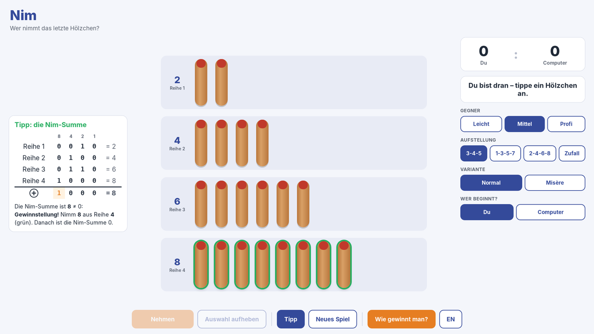

# Nim - Mathematik interaktiv

Das klassische Nim-Spiel gegen den Computer – mit eingebauter Erklärung der Gewinnstrategie über Binärzahlen und XOR.

Umgesetzt nach einem Besuchervorschlag aus der Feedback-Abstimmung am Galadriel-Kiosk
(Mathematisches Institut, Universität Freiburg).

## Screenshot


## Funktionen
- Computer-Gegner: Leicht, Mittel, Profi (optimal)
- Normalspiel und Misère, verschiedene Startaufstellungen
- „Tipp“: Binärtabelle, Nim-Summe und hervorgehobener Gewinnzug
- Erklärung auf Deutsch und Englisch, Vorführmodus Computer gegen Computer

## Mathematische Konzepte
- Nim-Summe (bitweises XOR) und Satz von Bouton (1901)
- Misère-Variante
- Satz von Sprague-Grundy (kombinatorische Spieltheorie)

## Projektstruktur

- `index.html`: komplette Anwendung (HTML, CSS, JavaScript in einer Datei, keine externen Ressourcen).
- `show.py`: Python-GTK3/WebKit2-Wrapper für die Vollbildanzeige (X, ESC oder Q schließt).
- `start-nim`: Startskript für den Galadriel-Kiosk.

DOM/CSS, keine externen Ressourcen; Spiellogik als reine Funktionen (LOGIC-START/END), gegen Brute-Force aller Stellungen geprüft.

## Starten der Anwendung

### Standalone (lokaler Browser)
`index.html` in einem modernen Webbrowser öffnen.

### Standalone (Vollbild-Fenster)
```bash
python3 show.py
```
Benötigt `python3-gi` und `gir1.2-webkit2-4.1` (Ubuntu 24.04).

### Über Galadriel (Kiosk-Modus)
Als Submodul `nim/` im Galadriel-Repository, Start über `./start nim` bzw.:
```bash
./start-nim
```
